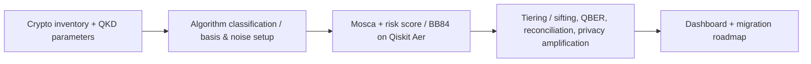
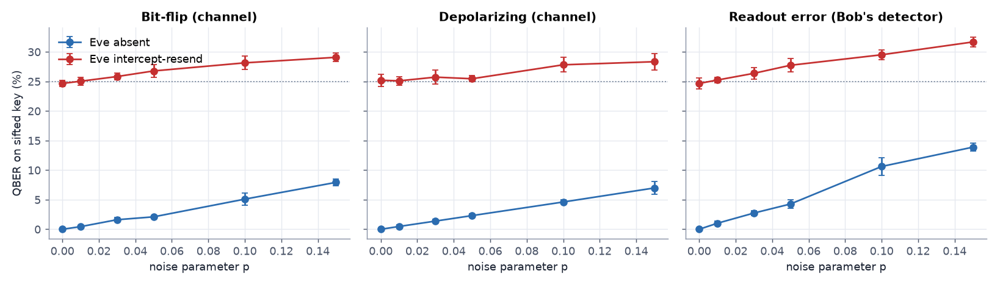

<div align="center">

# HackersLobby

**VTU-QFF-HC-0108** &nbsp;|&nbsp; Tier: **Both**

</div>

---

<div align="center">

| | |
| :--- | :--- |
| **Team** | HackersLobby |
| **Team ID** | VTU-QFF-HC-0108 |
| **Tier** | Both |
| **Repository** | [vtu-hc-hackerslobby](https://github.com/vtu-qiskit-fall-fest-2026/vtu-hc-hackerslobby.git) |
| **Organisation** | [vtu-qiskit-fall-fest-2026](https://github.com/vtu-qiskit-fall-fest-2026) |
| **Event** | VTU-QFF Hackathon — VTU-Qiskit Fall Fest 2026 |

</div>

---

## 📌 Table of Contents

- [Team Members](#-team-members-github-ids)
- [Problem Statement](#-problem-statement)
- [Proposed Solution](#-proposed-solution)
- [Approach & Architecture](#-approach--architecture)
- [Tech Stack](#-tech-stack)
- [Project Structure](#-project-structure)
- [How to Run](#-how-to-run)
- [How to Push Code](#-how-to-push-code)
- [Submission Checklist](#-submission-checklist)
- [Resources](#-resources)
- [License](#-license)

---

## 👥 Team Members (GitHub IDs)

> Members are added to this repository as **collaborators** and must accept the
> GitHub invitation before they can push. Add your GitHub username below.

| # | Name | GitHub Username | Role |
| :-- | :--- | :--- | :--- |
| 1 | Sahinur Rahman | https://github.com/sahinurrahman-debug | _Team Lead_ |
| 2 | Subhraditya Ghosh | https://github.com/SubhroEZ | _Developer_ |
| 3 | Archisman Halder | https://github.com/Archi84-bit | _Developer_ |

<!--
Optional: add a plain list instead of the table above.
- @username1
- @username2
-->

---

## ❓ Problem Statement

<!--
State the problem you are solving. Be specific: what is broken or missing,
who experiences it, and why does it matter. Link to the official problem
statement from the brief if one applies.
-->

**Problem:** Adversaries can record encrypted traffic today and decrypt it once a cryptographically relevant quantum computer exists (*Harvest Now, Decrypt Later*). Organisations rarely know which systems depend on quantum-vulnerable public-key cryptography (RSA, elliptic-curve, finite-field Diffie–Hellman), which of them hold data that must stay confidential for decades, or how urgently each must migrate. Quantum-secure communication such as QKD is often proposed without asking where it actually fits.

**Why it matters:** Migration takes years of planning, testing and deployment, so waiting for a working quantum attack is too late for long-lived sensitive data such as health records, research archives and device firmware. A defensible plan needs an inventory, an explicit and adjustable threat assumption, and an honest comparison of QKD with post-quantum cryptography (PQC).

**Track / Category:** Track 1 · Quantum Cryptography & Security

---

## 💡 Proposed Solution

<!--
Describe your solution. Keep it concrete: the core idea, the user flow, and
the quantum/ML technique you are applying.
-->

**Solution:** **QuantVault: Quantum-Aware Cryptographic Risk & Migration Framework.** It combines three layers: *discovery* (a cryptographic inventory of a sample hospital, classified by algorithm and role), *decision-making* (Mosca's inequality `X + Y > Z` plus a configurable risk score, with a threat-horizon slider and a generated five-phase migration roadmap) and *demonstration* (a Qiskit/Aer BB84 simulator with an intercept-resend eavesdropper, noise models, error reconciliation and privacy amplification). Everything is shown in a **MERN dashboard** (MongoDB + Express + React, in `web/`) with an editable inventory and four analysis pages: exposure overview, risk prioritisation, QKD laboratory, and migration & QKD-vs-PQC. A zero-dependency static version is also generated at `docs/dashboard.html`.

**Key idea:** Use the quantum simulation to show *how* eavesdropping is detected, and use the risk engine to decide *where* quantum-safe measures matter. PQC is the first step for most systems; QKD is flagged only for fixed, high-value point-to-point links.

**Why this works:** It turns an abstract future threat into a prioritisation problem an organisation can act on today. Unknown configurations are never treated as safe, forward secrecy is not mistaken for quantum safety, every assumption is exposed, and the simulation reports its finite-size statistics and limitations instead of claiming a low QBER proves security. In the simulation an intercept-resend attacker on every qubit gives a sifted-key QBER of about 25 % and aborts the run, while moderate channel noise still yields a shorter key.

---

## 🧩 Approach & Architecture

<!--
Walk through how it works. A simple pipeline diagram in text or Mermaid is ideal.
-->



1. **Input** — `data/inventory.json` (assets, algorithms, confidentiality lifetime X, migration time Y, exposure) plus the assumed threat horizon Z; for the simulator, qubit count, Eve on/off, noise model and parameter `p`.
2. **Preprocessing** — each algorithm is classified by role (key establishment, signature, symmetric, hash) and quantum-era class using the catalogue in `src/algorithms.py`; unknown configurations stay marked unknown. BB84 bits and bases are drawn at random and grouped into circuits.
3. **Quantum core** — Qiskit circuits executed on Qiskit Aer: Alice's encoding (X/H gates), Eve's measure-and-resend, a noisy channel (bit-flip, depolarizing, readout error) and Bob's basis measurement. Risk side: Mosca's inequality and `R = 100(0.35C + 0.25Q + 0.20E + 0.20M)`.
4. **Post-processing** — sifting, QBER estimation with a finite-sample upper bound, simplified Cascade reconciliation with leakage accounting, verification and Toeplitz privacy amplification; risk tiers and rule-based recommendations.
5. **Output** — the React dashboard served by Express (exposure overview, risk prioritisation with a Z slider, editable inventory stored in MongoDB, QKD laboratory with saved run history, migration roadmap and QKD-vs-PQC comparison), the static `docs/dashboard.html`, and the CLI reports. Express calls the Python engines through `src/bridge.py`, so the scoring and simulation logic exists only once.



Method details, formulas and security limitations are in [docs/METHODOLOGY.md](docs/METHODOLOGY.md).

---

## 🛠️ Tech Stack

| Layer | Technology |
| :--- | :--- |
| Language | Python 3.11+ |
| Quantum SDK | Qiskit `>=1.0,<2.0`, Qiskit Aer |
| Statistics | NumPy / SciPy (Clopper–Pearson bound, Toeplitz hashing) |
| Simulation | AerSimulator (bit-flip, depolarizing and readout noise models) |
| Analytics | pandas, Matplotlib |
| Web app (MERN) | MongoDB (Mongoose), Express, React 19 (Vite), Tailwind CSS 4 with a dark liquid-glass design system, Recharts, Node.js 20+ |
| Static dashboard | Self-contained HTML/JavaScript generated by Python (no extra dependencies) |
| Testing | pytest |
| Environment | JupyterLab / VS Code, `venv` |
| Version control | Git + GitHub |

---

## 📁 Project Structure

```text
vtu-hc-hackerslobby/
├── README.md              # This file
├── requirements.txt       # Python dependencies
├── pyproject.toml         # Project metadata and pytest settings
├── .gitignore
├── notebooks/             # Jupyter notebooks for experiments
│   └── exploration.ipynb
├── src/
│   ├── __init__.py
│   ├── algorithms.py      # Cryptographic algorithm catalogue and quantum-era classes
│   ├── risk.py            # Mosca's inequality, risk score, tiers, recommendations, roadmap
│   ├── bb84.py            # Qiskit/Aer BB84 circuits, Eve, noise models
│   ├── postprocessing.py  # QBER bound, Cascade reconciliation, privacy amplification
│   ├── experiments.py     # Experiments A–D, sweeps and figures
│   ├── comparison.py      # QKD vs PQC content and model limitations
│   ├── dashboard.py       # Builds docs/dashboard.html
│   ├── dashboard_template.html
│   ├── bridge.py          # JSON bridge: the Express API calls the Python engines through it
│   └── main.py            # Entry point (CLI)
├── web/                   # MERN app
│   ├── package.json       # Root scripts: dev, build, start, test
│   ├── server/            # Express + Mongoose API (assets, risk, QKD runs, experiments)
│   │   ├── src/           # app.js, auth.js, models.js, db.js, python.js, validate.js, http.js, index.js
│   │   └── test/          # API tests against a real MongoDB (node:test)
│   └── client/            # React (Vite) dashboard: pages/, components/, api.js
├── data/                  # Datasets (use Git LFS for large files)
│   └── inventory.json     # Illustrative sample hospital inventory
├── tests/                 # Unit tests
│   ├── test_circuit.py    # BB84 circuits and quantum phase
│   ├── test_postprocessing.py
│   ├── test_bridge.py
│   └── test_risk.py
└── docs/                  # Notes, diagrams, reports
    ├── METHODOLOGY.md     # Formulas, assumptions, limitations
    ├── dashboard.html     # Self-contained dashboard (open in a browser)
    └── figures/           # Generated plots
```

---

## 🚀 How to Run

### Prerequisites

- Python 3.11 – 3.13 (Qiskit 1.x, as pinned in `requirements.txt`, has no wheels for Python 3.14)
- [Git](https://git-scm.com/downloads)
- [Node.js](https://nodejs.org/) 20+ (only for the MERN dashboard in `web/`)
- A GitHub account (you need collaborator access to this repo)

### 1. Clone the repository

```bash
git clone https://github.com/vtu-qiskit-fall-fest-2026/vtu-hc-hackerslobby.git
cd vtu-hc-hackerslobby
```

### 2. Create a virtual environment

```bash
python3 -m venv .venv
source .venv/bin/activate        # Linux / macOS
# .venv\Scripts\activate         # Windows (PowerShell)
```

### 3. Install dependencies

```bash
pip install --upgrade pip
pip install -r requirements.txt
```

### 4. Run

```bash
python -m src.main
```

This prints the risk table, runs BB84 with and without Eve, runs experiments A–D and rebuilds `docs/dashboard.html` (open it in a browser). Useful variants:

```bash
python -m src.main risk --horizon 10        # risk assessment for a chosen threat horizon Z
python -m src.main qkd --qubits 4096 --eve  # one BB84 run with an eavesdropper
python -m src.main dashboard --quick        # faster, smaller experiment grid
```

Or launch the notebook workflow:

```bash
jupyter lab
```

### 5. Run the tests

```bash
pytest -q
```

### 6. Run the MERN dashboard

Requires [Node.js](https://nodejs.org/) 22+, the Python environment from step 3 (the API calls it) and a free [MongoDB Atlas](https://www.mongodb.com/atlas) cluster. Every run uses the same Atlas database, so the data is identical on every machine that connects to it.

```bash
cd web
npm run install:all
npm run setup:db               # once: paste your Atlas connection string; it is tested and saved to web/server/.env
npm run dev                    # API on :5000, React on http://localhost:5173
```

On another machine, run the same three commands (or copy the `.env` file) and you will see the same accounts and data. In Atlas, **Network Access** must allow that machine's IP address. The server refuses to start without `MONGODB_URI` rather than quietly using a private local database; for offline work only, set `USE_LOCAL_DB=true`.

Production-style (Express serves the built React app on http://localhost:5000):

```bash
npm run build
npm start                      # uses MONGODB_URI from the environment or web/server/.env
npm test                       # API tests; they use their own temporary database and never touch Atlas
```

See `web/server/.env.example` for the settings (`MONGODB_URI`, `PORT`, `PYTHON_BIN`).

**Demo account.** The sign-in page shows demo credentials (`demo@quantvault.app` / `DemoPass-2026!`) with a one-click button. It is a shared sandbox reset to the sample data on every sign-in; set `DEMO_ACCOUNT=false` to turn it off.

**Accounts.** Open `/signup` to create an account, then `/login` to sign in; `/dashboard` is protected and redirects visitors to the sign-in page. Each account gets its own private copy of the sample inventory, QKD run history and experiment results. Sessions use a random token in an `httpOnly`, `SameSite=Lax` cookie (`Secure` with a `__Host-` prefix in production); only a SHA-256 of the token is stored server-side. Passwords are hashed with scrypt, every data route requires a session and filters by owner, writes from other origins are rejected, and repeated failed sign-ins are rate-limited.

---

## 🔁 How to Push Code

> Full walkthrough: **[Git & Collaboration Handbook](../vtu-hc-guide-git-and-collaboration)** — collaboration
> workflow, branches, pull requests, reviews and conflict resolution.

### Configure Git (first time only)

```bash
git config --global user.name  "Your Name"
git config --global user.email "you@example.com"
```

### Everyday workflow

```bash
# 1. Get the latest changes
git checkout main
git pull origin main

# 2. Create a branch for your work
git checkout -b feature/my-task

# 3. Commit your work
git add .
git commit -m "feat: add variational circuit for the search problem"

# 4. Push the branch
git push -u origin feature/my-task

# 5. Open a Pull Request on GitHub and request a review
#    https://github.com/vtu-qiskit-fall-fest-2026/vtu-hc-hackerslobby/compare/main...feature/my-task

# 6. After approval, merge into main
git checkout main
git pull origin main
git branch -d feature/my-task
```

### Commit message convention

| Prefix | Meaning |
| :--- | :--- |
| `feat:` | New feature |
| `fix:` | Bug fix |
| `docs:` | Documentation only |
| `test:` | Adding or fixing tests |
| `refactor:` | Code restructure, no behaviour change |
| `chore:` | Build/config/dependency changes |

### Useful commands

```bash
git status              # what changed
git log --oneline -10   # recent commits
git diff                # review changes before committing
git stash               # shelve changes temporarily
git pull --rebase       # update your branch on top of main
```

### Collaborating on the same repo

- **Never push directly to `main`** — open a Pull Request.
- **Pull before you push** to avoid rejected commits.
- **Commit often** with clear messages.
- **Resolve conflicts** locally: `git pull --rebase`, fix the files, then `git add` + `git rebase --continue`.
- **Ask for a review** before merging — a second pair of eyes catches bugs fast.

---

## ✅ Submission Checklist

- [ ] Repository created and **public**
- [ ] All team members added as **collaborators** and invitations accepted
- [x] `README.md` updated with project details, problem statement and solution
- [ ] Team members listed under [Team Members](#-team-members-github-ids)
- [ ] `requirements.txt` committed and project runs from a clean clone
- [ ] Code pushed to `main` and the latest `main` builds successfully
- [ ] Notebooks committed with **cleared outputs** (or use `nbstrip`)
- [ ] `README` includes a demo screenshot / video link
- [ ] Short project summary submitted on the hackathon portal

---

## 📚 Resources

| Resource | Link |
| :--- | :--- |
| 🔁 Git & collaboration handbook | [Git & Collaboration Handbook](../vtu-hc-guide-git-and-collaboration) |
| ❓ Problem statements, solutions & terms | [Problem Statements, Solutions & Terms](../vtu-hc-guide-problem-and-solution) |
| 📄 README writing guide | [README Guide & Template](../vtu-hc-guide-readme-template) |
| ⚛️ Qiskit documentation | https://docs.quantum.ibm.com/ |
| ⚛️ Qiskit Runtime & primitives | https://quantum.cloud.ibm.com/docs/ |
| 🧪 Qiskit Aer simulator | https://docs.quantum.ibm.com/guides/simulator |
| 💻 IBM Quantum Platform | https://quantum.cloud.ibm.com/ |
| 🎓 Qiskit textbook | https://qiskit.qotlabs.org/learning/ |
| 📋 GitHub Docs | https://docs.github.com/ |

---

## 📄 License

Released under the [MIT License](LICENSE). See `LICENSE` for details.

---

<div align="center">

**HackersLobby** · Team ID `VTU-QFF-HC-0108` · Tier `Both`
· Built with ⚛️ Qiskit for the VTU-QFF Hackathon

[⬆ Back to Top](#hackerslobby)

</div>
